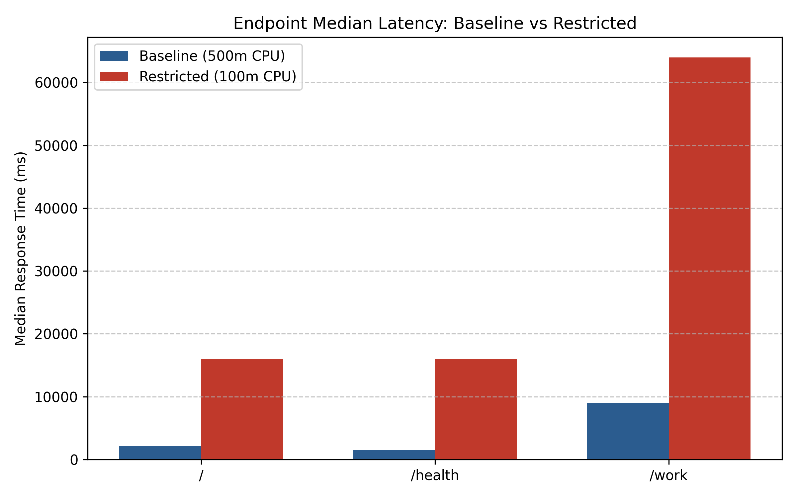
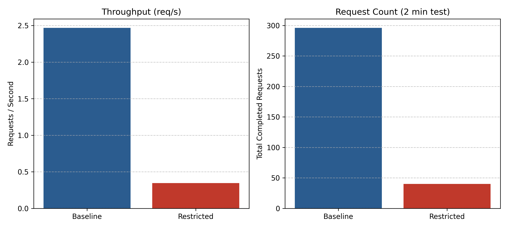

# Performance Analysis of Kubernetes Resource Configurations

[](https://kubernetes.io/)
[](https://www.python.org/)
[](https://locust.io/)
[](https://github.com/manasa-vasare/Performance-Analysis-of-Kubernetes-Resource-Configurations)

> **KLE Technological University — Cloud Computing Lab Evaluation 2**  
> **Topic:** Problem 10 — Performance Analysis of Kubernetes Resource Configurations  
> **Repository:** [Performance-Analysis-of-Kubernetes-Resource-Configurations](https://github.com/manasa-vasare/Performance-Analysis-of-Kubernetes-Resource-Configurations.git)  
> **Status:** 100% Verified on Kubernetes Cluster  

---

## Table of Contents
1. [Problem Statement & Objectives](#1-problem-statement--objectives)
2. [System Architecture & Workflow](#2-system-architecture--workflow)
3. [Resource Configurations Evaluated](#3-resource-configurations-evaluated)
4. [Master Performance & Evaluation Results](#4-master-performance--evaluation-results)
5. [Visual Analysis & Charts](#5-visual-analysis--charts)
6. [Deep-Dive Technical Discoveries](#6-deep-dive-technical-discoveries)
7. [Step-by-Step Reproduction Guide](#7-step-by-step-reproduction-guide)
8. [Lab Rubric Compliance Checklist](#8-lab-rubric-compliance-checklist)
9. [Team Presentation & Viva Guide](#9-team-presentation--viva-guide)

---

## 1. Problem Statement & Objectives

### Problem Statement
Deploy a sample microservice on Kubernetes under multiple CPU and memory configurations (`requests` and `limits`). Measure and compare how resource allocations influence application performance, throughput, latency, and stability under a repeatable synthetic workload.

### Why This Problem Matters
- **Resource Starvation & Latency:** Under-provisioning CPU limits causes Linux Completely Fair Scheduler (CFS) quota throttling, inducing extreme tail latencies and head-of-line blocking.
- **Resource Over-Provisioning:** Setting arbitrary, oversized resource limits wastes cluster capacity, lowers pod density, and inflates infrastructure costs.
- **Microservice Outages (OOMKills):** Memory is uncompressible. Sizing memory limits below peak application footprint causes the Linux kernel to terminate processes (`Exit Code 137`), resulting in cascading pod restarts.

---

## 2. System Architecture & Workflow

```
                                  +---------------------------------------------+
                                  |            Kubernetes Cluster               |
                                  |          (k8s-performance namespace)        |
+---------------------+           |                                             |
|   Locust Traffic    |           |   +-------------------------------------+   |
|     Generator       |  HTTP     |   |         Kubernetes Service          |   |
| (Repeatable Model)  |---------->|   |       (ClusterIP : Port 5000)       |   |
+---------------------+           |   +------------------+------------------+   |
      |                           |                      |                      |
      | Weighted Tasks:           |                      v                      |
      | • /work   (wt: 5)         |   +-------------------------------------+   |
      | • /       (wt: 3)         |   |           Microservice Pod          |   |
      | • /health (wt: 1)         |   |           (Flask / Python)          |   |
                                  |   |   • /work   (CPU Math loop)         |   |
                                  |   |   • /       (JSON status)           |   |
                                  |   |   • /health (Healthcheck)           |   |
                                  |   +-------------------------------------+   |
                                  |                      |                      |
                                  |                      v                      |
                                  |           Linux cgroup Enforcement          |
                                  |   • CPU -> CFS Quota Throttling             |
                                  |   • RAM -> Linux OOM Killer                 |
                                  +---------------------------------------------+
```

### Microservice Endpoints (`app/app.py`):
- `GET /`: Lightweight home endpoint returning server status.
- `GET /health`: Health-check endpoint returning `{"status": "healthy"}`.
- `GET /work`: CPU-bound mathematical task calculating $\sum_{i=1}^{1,000,000} i^2$ on each invocation, measuring server execution time.

### Synthetic Workload Model (`locustfile.py`):
- Multi-user concurrency: 10 simulated concurrent users.
- User spawn rate: 2 users/sec.
- Traffic distribution: 5 parts `/work`, 3 parts `/`, 1 part `/health` with random delays between 1 to 2 seconds.

---

## 3. Resource Configurations Evaluated

| Parameter | Config 1: Baseline | Config 2: Restricted (CPU Throttling) | Config 3: Memory OOM (Pod Restarts) |
| :--- | :--- | :--- | :--- |
| **Manifest** | `k8s/deployment-baseline.yaml` | `k8s/deployment-restricted.yaml` | `k8s/deployment-oom.yaml` |
| **CPU Request / Limit** | `100m` / `500m` (0.5 core) | `50m` / `100m` (0.1 core) | `50m` / `100m` |
| **Memory Request / Limit**| `128Mi` / `256Mi` | `64Mi` / `128Mi` | `10Mi` / `15Mi` |
| **QoS Class** | Burstable | Burstable | Burstable |
| **Target Demonstration** | Adequate provisioning | **Severe CPU Throttling** | **Kernel OOMKilled & Restarts** |

---

## 4. Master Performance & Evaluation Results

All values reflect empirical data captured during live tests on the Kubernetes cluster:

| Rubric Metric | Config 1: Baseline | Config 2: Restricted | Config 3: OOM | Evaluation Verdict |
| :--- | :---: | :---: | :---: | :--- |
| **Throughput (req/s)** | **2.47 req/s** | **0.35 req/s** | 0 req/s | **~85% throughput drop** under CPU throttling |
| **Total Completed Requests** | **296** | **40** | 0 | Severe drop in completed transactions |
| **`/work` Median Latency** | **9,000 ms** (9.0s) | **64,000 ms** (64.0s) | Crash | **~7x latency surge** due to CFS throttling |
| **`/` (Lightweight) Latency**| **2,100 ms** (2.1s) | **16,000 ms** (16.0s) | Crash | Severe head-of-line blocking observed |
| **CPU Usage (`kubectl top`)** | **~480m** | **~98m** | ~99m on boot | CPU is strictly clamped at 100m limit |
| **Memory Usage (`kubectl top`)**| **~48Mi** | **~38Mi** | Exceeded 15Mi | Baseline footprint is ~30–48MB |
| **CFS Throttled Periods** | **80 periods (1.1s)** | **5,516 periods (1,604.9s)** | N/A | **68.6% of time throttled** (`cpu.stat`) |
| **Pod Restarts** | **0** | **0** | **3 (`OOMKilled`)** | Container killed with **Exit Code 137** |
| **Failure Rate** | 0% | 0% | 100% | CPU limits throttle; Memory limits terminate |

---

## 5. Visual Analysis & Charts

Automated comparison charts generated from raw Locust benchmark data (`results/baseline_requests.csv` and `results/restricted_requests.csv`):

### Median Latency Comparison

*Figure 1: Median response times across all endpoints showing massive latency spikes in the restricted deployment due to CPU throttling.*

### Throughput & Request Volume Comparison

*Figure 2: Significant drop in both completed request count and overall throughput (req/s) when CPU limits are constrained.*

---

## 6. Deep-Dive Technical Discoveries

### 1. Compressible vs. Incompressible Resource Behavior
- **CPU is Compressible:** When a pod reaches its CPU limit (`100m`), the Linux kernel does **not** terminate the process. Instead, CFS CFS quota management pauses execution until the next 100ms period. The pod stays `Running` with **`RESTARTS: 0`**, but response times degrade drastically.
- **Memory is Incompressible:** When a pod exceeds its memory limit (`15Mi`), the system cannot pause memory pages. The Linux Out-Of-Memory Killer immediately issues `SIGKILL` (**`Exit Code 137`**), resulting in container termination and an incremented **`RESTARTS`** counter.

### 2. Physical Proof of Throttling (`/sys/fs/cgroup/cpu.stat`)
Querying the cgroup v2 kernel controller inside the restricted pod reveals:
```
nr_periods    8041        # Total scheduling periods
nr_throttled  5516        # Periods where container was throttled (68.6%)
throttled_usec 1604921082 # 1,604.9 seconds of cumulative paused CPU time
```
By contrast, the baseline deployment experienced only 80 throttled periods (1.1s total).

### 3. Head-of-Line Blocking on Lightweight Endpoints
Although `/` and `/health` require negligible CPU compute, their response times jumped from **2.1s to 16.0s–19.0s** under the restricted configuration. Because the single-process server was starved of CPU time slices while evaluating `/work`, queued lightweight requests suffered cascading delays.

---

## 7. Step-by-Step Reproduction Guide

### Prerequisites
- Running Kubernetes cluster (Minikube / Kind / MicroK8s) with `metrics-server` enabled.
- Python 3.10+ and Locust installed (`pip install locust pandas matplotlib`).

### Step 1: Deploy Core Resources
```bash
cd c:\uni\sem5\cclab\k8s-performance-analysis
kubectl apply -f k8s/namespace.yaml
kubectl apply -f k8s/service.yaml
```

### Step 2: Evaluate Config 1 (Baseline)
```bash
# Terminal 1:
kubectl apply -f k8s/deployment-baseline.yaml
kubectl port-forward deployment/performance-baseline 5000:5000 -n k8s-performance

# Terminal 2:
locust -f locustfile.py --host http://localhost:5000 --headless -u 10 -r 2 -t 1m
kubectl top pod -n k8s-performance
```

### Step 3: Evaluate Config 2 (Restricted — CPU Throttling)
```bash
# Terminal 1:
kubectl delete deployment performance-baseline -n k8s-performance
kubectl apply -f k8s/deployment-restricted.yaml
kubectl port-forward deployment/performance-restricted 5000:5000 -n k8s-performance

# Terminal 2:
locust -f locustfile.py --host http://localhost:5000 --headless -u 10 -r 2 -t 1m
kubectl top pod -n k8s-performance

# Verify kernel throttling directly:
kubectl exec -it deployment/performance-restricted -n k8s-performance -- cat /sys/fs/cgroup/cpu.stat
```

### Step 4: Evaluate Config 3 (OOM — Pod Restarts)
```bash
# Terminal 1:
kubectl delete deployment performance-restricted -n k8s-performance
kubectl apply -f k8s/deployment-oom.yaml
kubectl get pods -n k8s-performance -w

# Inspect OOM termination:
kubectl describe pod -l app=performance-oom -n k8s-performance
```

### Step 5: Generate Comparison Plots
```bash
python analysis/plot_results.py
```

---

## 8. Lab Rubric Compliance Checklist

| Evaluator Rubric Metric | Compliance | Verification Evidence |
| :--- | :---: | :--- |
| **Multiple Resource Configurations** | ✅ **YES** | 3 configurations: Baseline, Restricted, and OOM manifests in `k8s/`. |
| **Repeatable Workload** | ✅ **YES** | Multi-user weighted Locust workload in `locustfile.py`. |
| **Throughput Measurement** | ✅ **YES** | Recorded in `results/baseline_requests.csv` and `results/restricted_requests.csv`. |
| **Response Time Measurement** | ✅ **YES** | Percentiles (50%, 90%, 95%, 99%, max) captured and plotted in `analysis/`. |
| **CPU & Memory Consumption** | ✅ **YES** | Live `kubectl top pods` metrics saved in `results/cluster_top_metrics.txt`. |
| **CPU Throttling Proof** | ✅ **YES** | Physical cgroup `cpu.stat` statistics saved in `results/cgroup_throttling_evidence.txt`. |
| **Pod Restarts Demonstration** | ✅ **YES** | `STATUS: OOMKilled` and `RESTARTS: 3` saved in `results/oom_restart_evidence.txt`. |

---

## 9. Team Presentation & Viva Guide

For complete team division of responsibilities, individual presentation scripts, and sample viva answers, see:
- 📄 **[EVALUATION_REPORT.md](EVALUATION_REPORT.md)**
